# Code flow

Updated: 2026-10-11. This describes **current foundations, authenticated readiness and finite UDP/TCP CLI/accounting**. Bounded persistence, replay/export, authenticated reconciliation, SSH clock captures, one-way estimates and protected configuration/run/report API are implemented. Production clock bounds, dashboard/live views, comparisons and full acceptance remain pending. Each function has a purpose comment; `go test ./internal/quality -v` audits it. [Roadmap task index](ROADMAP.md#first-slice-task-index) tracks remaining work.

## Start reading here

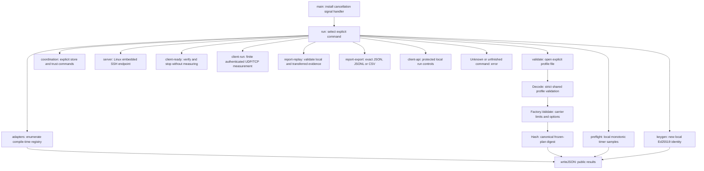

Entry points: [main.go](cmd/sneaky-port/main.go) (`main`, `run`, `writeJSON`), [coordination.go](cmd/sneaky-port/coordination.go) (`coordination`, `keyPassphrase`, `loadSigner`). `server` is Linux-only; `client-ready` uses direct owned UDP/TCP plus SSH control. `client-run` performs finite measurement; dashboard mode remains unsupported. Validation/preflight open no network sockets.

## Protected local run API

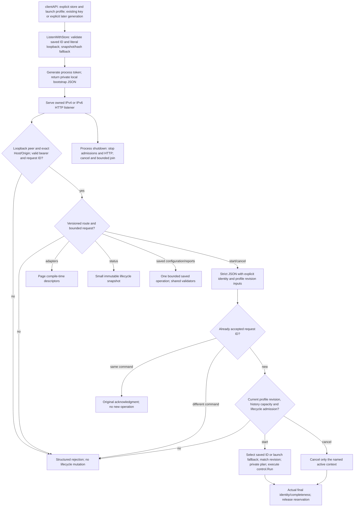

Sources: [launcher](cmd/sneaky-port/api.go) (`clientAPI`), [API](internal/localapi/server.go) (`Listen`, `ListenWithStore`, `handle`, `adapters`, `mutate`, `status`, `execute`, `Serve`, `Close`), [saved selection](internal/localapi/saved.go) (`selectedProfile`), [finite runner](internal/control/run.go) (`Run`), [security/lifecycle fixtures](internal/localapi/server_test.go), [real HTTP/SSH/UDP CLI fixture](cmd/sneaky-port/finite_test.go). HTTP contexts never schedule/cancel owned traffic. API handles differ from eventual measurement IDs; unknown readiness/completeness remain null until runner return. Tokens stay out of URLs/HTTP output. Active state has no fabricated phase/live samples. [Saved operations](#saved-configuration-and-report-api) are implemented; dashboard/live views and comparison remain pending. The [operator contract](README.md#protected-local-run-api) records exact bounds.

## Saved configuration and report API

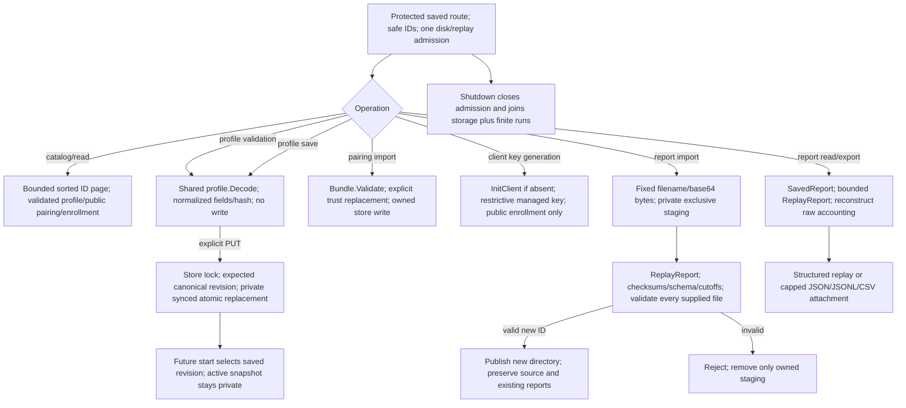

Sources: [routes](internal/localapi/saved.go) (`saved`, `catalog`, `savedBody`, `profileWrite`, `pairingImport`, `keyCreate`, `reportImport`, `reportExport`, `diskReply`), [store](internal/control/saved.go) (`ownedDir`, `SavedIDs`, `Profile`, `SaveProfile`, `SavedReport`, `ImportReport`), [trust/key store](internal/control/store.go) (`ImportPairing`, `Pairing`, `InitClient`), [replay](internal/control/replay.go) (`ReplayReport`), [exports](internal/control/export.go) (`ExportReport`), [store fixtures](internal/control/saved_test.go), [HTTP fixtures](internal/localapi/saved_test.go), [real HTTP/SSH report fixtures](cmd/sneaky-port/finite_test.go). Saved bodies cap at 1 MiB including base64 overhead; catalog inspection at 256 entries; replay reads at 8 MiB; export at 16 MiB. Busy saved requests reject with 503. Offline integrity cannot authenticate imported evidence or verify clock bounds; cached reconciliation is excluded. No import resumes traffic or remotely enrolls a client. Remaining UI/comparison paths are tasks 19-21.

## Persistent trust and endpoint readiness

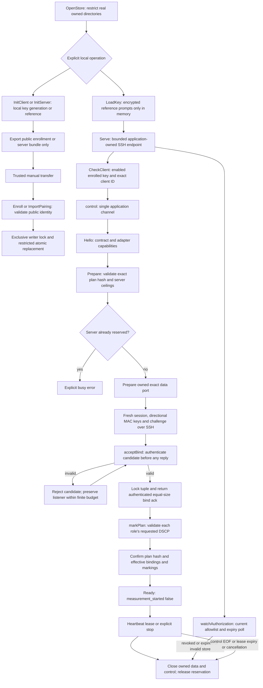

Sources: [store.go](internal/control/store.go) (`OpenStore`, `InitClient`, `InitServer`, `Enroll`, `ImportPairing`), [session.go](internal/control/session.go) (`NewServer`, `Serve`, `connection`, `control`, `Ready`, `acceptBind`, `checkBind`, `watchAuthorization`). Host pinning precedes session secrets. Shell/exec/forwarding and premature/extra channels are refused; one calibration channel is admitted during a finite run and one report channel after stop. Invalid UDP first tuples cannot elicit a reply or pin the listener; partial TCP frames cannot authenticate. Fresh identities/challenges/keys never enter public results.

Both roles retain actual local/remote bindings; NAT observations need not equal the client's local tuple. Marking API success leaves packet-observed values unknown. Readiness holds only a lease, counts client application-control bytes through stop, and performs no scheduler/ledger/calibration run. Readiness-only cleanup produces no measurement samples. [Tests](internal/control/session_test.go), [store tests](internal/control/store_test.go), [setup commands](README.md#pair-endpoints-and-check-readiness).

## Finite run lifecycle

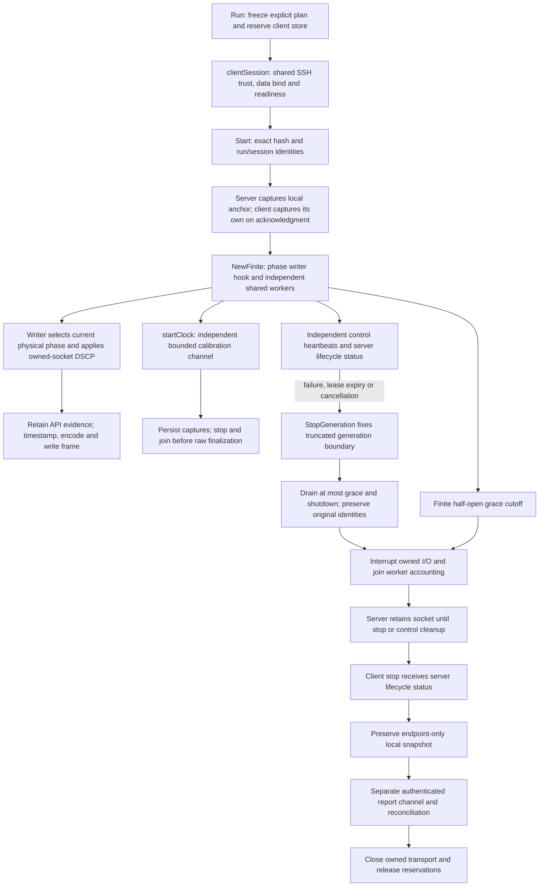

Sources: [run.go](internal/control/run.go) (`Run`, `executeRun`, `durationSum`), [session.go](internal/control/session.go) (`clientSession`, `control`), [finite.go](internal/engine/finite.go) (`NewFinite`, `phaseMarker`, `finish`, `Cancel`, `Wait`), [worker](internal/worker/endpoint.go) (`StopGeneration`, `write`, `receive`), [socket](internal/adapter/adapter.go) (`Interrupt`, `Mark`, `Close`). [Control fixtures](internal/control/run_test.go), [phase/cutoff fixtures](internal/engine/finite_test.go), [Linux marking fixtures](internal/control/run_linux_test.go), [CLI fixture](cmd/sneaky-port/finite_test.go).

Anchors/epochs are local to each run, with no shared-clock claim. Marking follows the current physical phase for queued data and receipts; original identities still determine measurement attribution. Quiet phases update on the next outgoing frame, and grace retains the last setting. Frames spanning boundaries and API success do not prove packet markings. A stopped generation cutoff is separate from observation/drain; late timer callbacks or read errors at/after the elapsed cutoff cannot relabel a full window as truncated. Early failures remain partial and server run heartbeats expose them. A server cutoff interrupts local I/O without early peer EOF; final socket cleanup belongs to control. The exclusive client lock is never stolen after a crash. The snapshot is also saved in task 12 local summaries; local replay/export and authenticated server reconciliation are implemented separately from endpoint-only snapshots. [Evidence](WORK_LOG.md#2026-10-11-finite-run-lifecycle).

## Profiles and planned slots

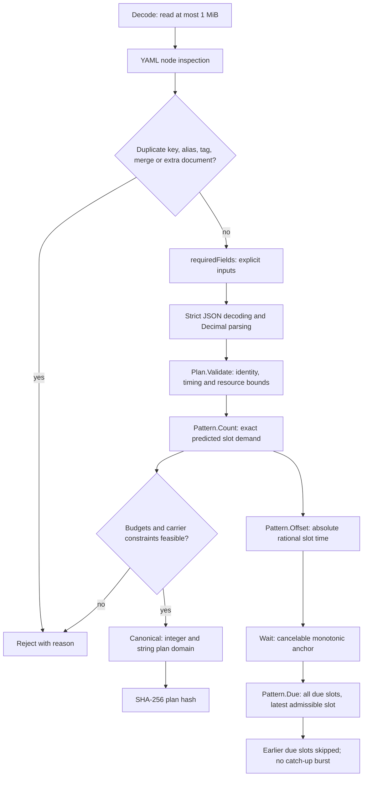

Sources: [profile.go](internal/profile/profile.go) (`Decode`, `requiredFields`, `yamlValue`, `Plan.Validate`), [canonical.go](internal/profile/canonical.go) (`Canonical`), [schedule.go](internal/schedule/schedule.go) (`Count`, `Offset`, `Due`, `Wait`), [preflight.go](internal/measure/preflight.go) (`Preflight`). The UDP/TCP workers/accounting below connect these patterns to I/O and the ledger across frozen windows. Half-open phases exclude the end, and quiet/burst gaps schedule no data.

## Bounded writer queues

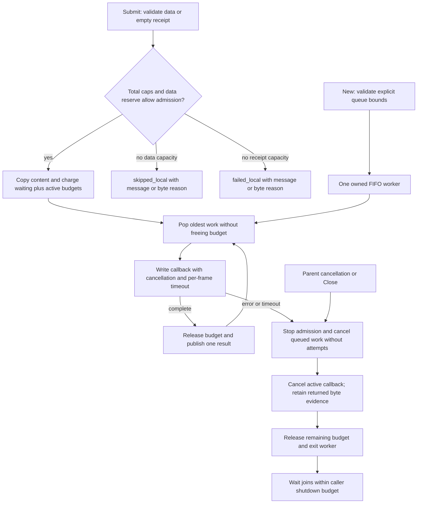

Sources: [queue.go](internal/writer/queue.go) (`New`, `Submit`, `Snapshot`, `run`, `stopLocked`, `popLocked`, `finishLocked`, `Close`, `Wait`), [fixtures](internal/writer/queue_test.go). Invalid/stopped submissions fail without tickets. Receipts share FIFO order and total caps; data cannot consume reserved message or 124-byte receipt capacity. Active work stays charged until the callback returns. One buffered result per accepted frame avoids blocking on report consumers; consumers own later result retention.

Callbacks own attempt timestamps, encoding, transport byte boundaries and cancellation of their owned I/O. They must return on cancellation/timeouts; arbitrary blocking code cannot be forcibly interrupted, and a bounded `Wait` exposes that violation. The queue performs no retry/drain, schedule accounting, transport writes or network-loss inference by itself. Callback fixtures and the following UDP/TCP integration are separate evidence.

## Independent UDP/TCP workers

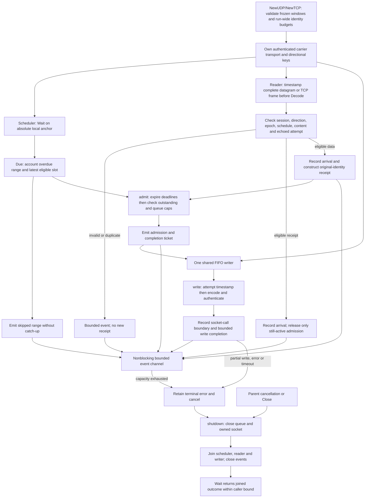

Sources: [UDP](internal/worker/udp.go) (`NewUDP`), [TCP](internal/worker/tcp.go) (`NewTCP`), [endpoint.go](internal/worker/endpoint.go) (`newEndpoint`, `validateSchedule`, `schedule`, `admit`, `write`, `receive`, `check`, `emit`, `shutdown`, `Wait`), [UDP fixtures](internal/worker/udp_test.go), [limit/correlation fixtures](internal/worker/udp_limits_test.go). Both endpoints run separate local schedules; neither reads, receipts nor a stalled writer advance their clocks. Data and reverse receipts share one queue/key per physical sender. Duplicate data produces no second receipt; duplicate receipts release outstanding capacity only once. Event content is omitted after frozen-pattern validation, while byte counts and all local timestamp boundaries remain explicit. A skipped-range event retains the first identity/count for later ledger expansion. Admission records precede their attempt events, but arrival may precede write completion.

Standalone constructors require prepared/authenticated transports and constant caller-applied markings; finite lifecycle supplies the phase writer hook. [windows.go](internal/worker/windows.go) (`PlanWindows`, `prepareWindows`, `windowFor`) freezes phase patterns/content and continuous origin sequences. [expiry.go](internal/worker/expiry.go) (`expireLocked`, `recordStop`) frees outstanding capacity strictly after deadlines before admission, retains late receipt matching and freezes the first observed stop. Interrupted scheduling accounts only slots strictly before that stop; quiet intervals add none. `Scheduled` closes at full generation end or stop while reads continue until cancellation. Joined timeline shutdown emits an observation cutoff. TCP uses the same workers with its larger authenticated-frame limit and four-byte prefix-inclusive write/arrival counts. Complete reads racing stop remain out-of-window evidence without fresh receipts. Adapter reads timestamp only complete frames; partial prefix/body/EOF/cancel evidence is a `read_error`, never an arrival. Failed/partial writes close the affected segment without reconnect. [TCP worker fixtures](internal/worker/tcp_test.go) cover actual stream blockage, prefix/body splitting and interrupted framing. Task 12 now persists local evidence; the finite lifecycle above connects start/marking/grace/CLI. [Timeline fixtures](internal/worker/windows_test.go), [evidence](WORK_LOG.md#2026-10-11-udp-phase-accounting).

## UDP/TCP phase accounting

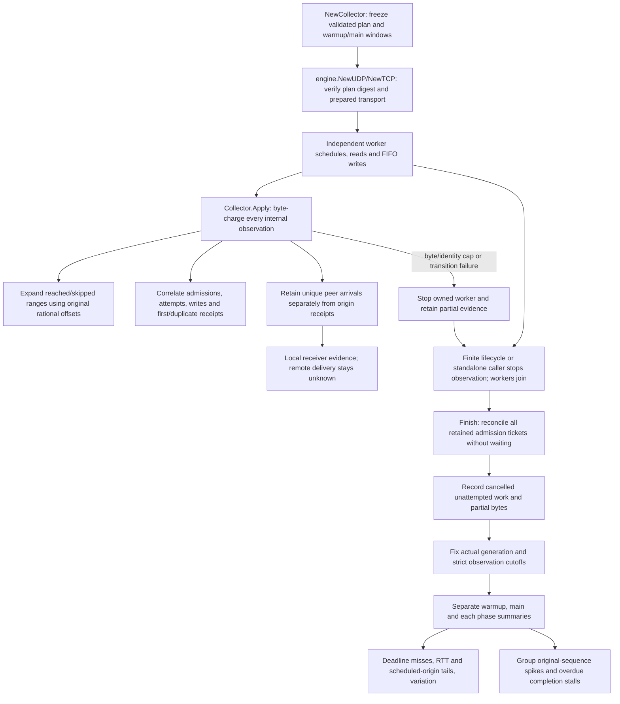

Sources: [engine/endpoint.go](internal/engine/endpoint.go) (`NewCollector`, `Apply`, `keep`, `Finish`, `newEndpoint`, `collect`, `Wait`), [UDP](internal/engine/udp.go) (`NewUDP`), [TCP](internal/engine/tcp.go) (`NewTCP`), [UDP fixtures](internal/engine/udp_test.go), [TCP fixtures](internal/engine/tcp_test.go), [analysis.go](internal/measure/analysis.go) (`Analyze`, `completionStalls`), [metric fixtures](internal/measure/analysis_test.go). Raw internal observations retain exact decimal quantities without keys/content/channels and stop visibly at `event_bytes`; task 12 persists these exact records as versioned event details; task 13 now replays these records through shared accounting. Actual queue completion tickets distinguish callback invocation from serialization attempts. Records at/after cutoff remain retained but cannot revise that summary; quantized equality stays excluded. Local `Complete` requires full generation/grace and intact evidence, and does not claim successful delivery or remote compatibility. Standalone constructors reject changing DSCP without a writer hook; finite lifecycle supplies it. Windows/Ubuntu/CentOS IPv4/IPv6 loopback and injected local failures are distinct from native ARM64, calibrated one-way, independent impairment and live acceptance.

## Real sockets and authenticated frames

The following primitive exchange is exercised by adapter loopback tests; finite control orchestration is described above.

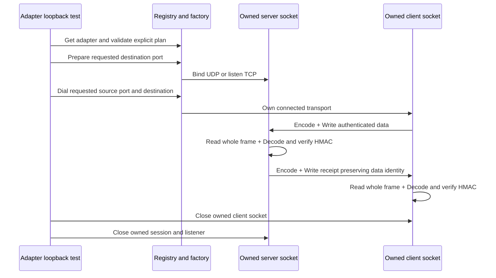

Sources: [adapter.go](internal/adapter/adapter.go) (`Register`, `Describe`, `Prepare`, `Dial`, `Accept`, `Reject`, `SetReadDeadline`, `Read`, `Write`, `Close`), [wire.go](internal/probe/wire.go) (`Encode`, `Decode`, `ReadTCP`, `WriteTCP`), [adapter tests](internal/adapter/adapter_test.go). UDP sends whole datagrams; TCP adds a four-byte length prefix. Decode checks the exact 92-byte header/124-byte authentication overhead, flags, content length and plan/adapter tag. Partial TCP frames never become arrivals. Production readiness uses the bind/challenge path above; UDP scheduled component traffic is described separately, and shared UDP/TCP scheduled component traffic is described above; the finite CLI orchestration above connects both carriers.

`socket.Mark` delegates to [Linux](internal/platform/marking_linux.go) or [Windows qWave](internal/platform/marking_windows.go). Requested, API-applied and independently observed marking are distinct; nonzero application failures return errors. No packet-capture/ECN acceptance gate has passed.

## Local accounting

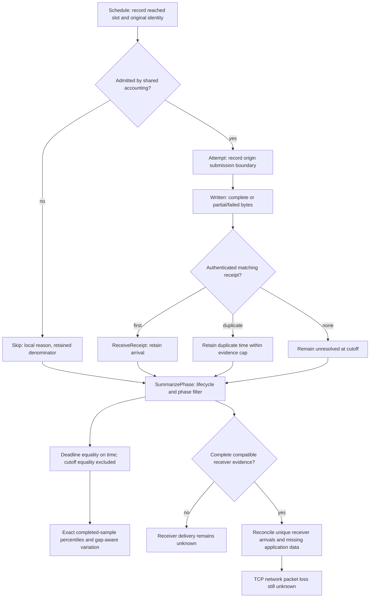

Source: [ledger.go](internal/measure/ledger.go). `Admit` and `Unattempted` retain local queue outcomes; `ReceiptProcessing` preserves a valid peer-local interval, with impossible RTT correction unavailable. `Summarize` selects main; `SummarizePhase` separates warmup/phase, and `SummarizePhases` partitions one snapshot without repeated full-ledger scans. Attempt/write/receipt and observed local-resolution boundaries obey strict cutoff filtering. `ReceiverEvidence` is caller-supplied: the engine exposes endpoint-only unknown delivery; the authenticated control report path now validates compatibility and supplies receiver evidence for separate reconciled snapshots. The ledger has one owner; concurrent mutation is unsupported.

## Trust and clock evidence

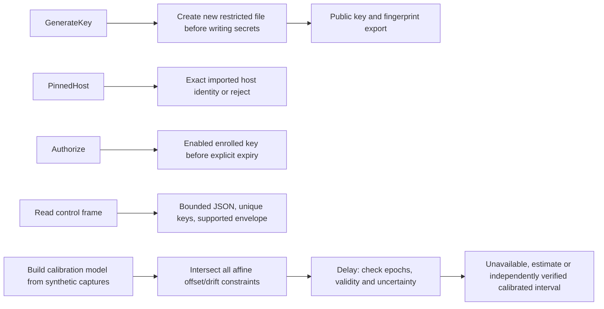

Sources: [identity.go](internal/control/identity.go), [key Windows](internal/control/key_windows.go), [key Linux](internal/control/key_linux.go), [control frames](internal/control/frame.go), [calibration.go](internal/calibration/calibration.go). `DecodeObject` rejects duplicate/unknown/missing fields, invalid UTF-8 and excessive nesting; the coordinator separately checks lifecycle identities. Calibration tests inject known captures; no live sampler supplies them yet. `Policy.Verified` is only enabled by synthetic fixtures; production cannot claim calibrated timing until the independent evidence gates pass.

## Local evidence persistence

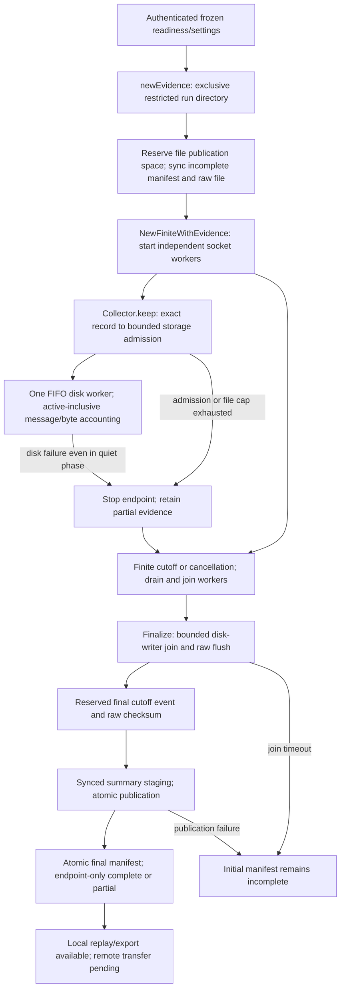

Sources: [evidence.go](internal/control/evidence.go) (`newEvidence`, `Append`, `writeLoop`, `Finalize`, `publishEvidence`), [engine collector](internal/engine/endpoint.go) (`Persistence`, `keep`, `collect`), [finite lifecycle](internal/engine/finite.go) (`NewFiniteWithEvidence`, `finish`), [client coordinator](internal/control/run.go) (`executeRun`), [server coordinator](internal/control/session.go) (`control`), [storage fixtures](internal/control/evidence_test.go), [failure integration](internal/engine/persistence_test.go). Both stores save their own evidence before measurement and finalize independently of the control connection. Raw files omit authentication objects, content and keys; decimal offsets stay host-local/uncalibrated. Manifest/settings are frozen public values. Existing run directories are not reused; failed or interrupted publication stays incomplete/partial. Actual filesystem calls cannot be forcibly cancelled portably; a storage join timeout leaves the owned disk worker responsible until its call returns. Power-loss/nonlocal-filesystem durability remains pending; authenticated receiver reconciliation is implemented in the separate path below.

## Local report replay and export

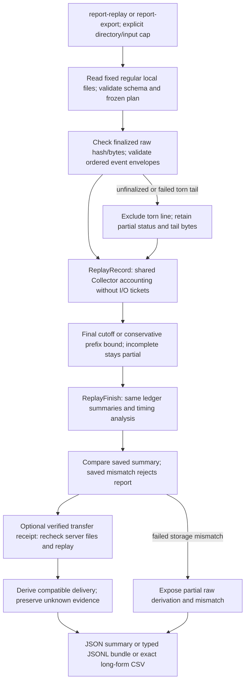

Sources: [replay.go](internal/control/replay.go) (`ReplayReport`, `reportFile`, `decodeReportObject`), [engine replay](internal/engine/replay.go) (`ReplayRecord`, `ReplayFinish`), [shared collector](internal/engine/endpoint.go) (`apply`, `Finish`), [export.go](internal/control/export.go) (`ExportReport`, `exportCSVValue`, `reportUnit`), [CLI](cmd/sneaky-port/main.go) (`run`), [report fixtures](internal/control/replay_test.go), [completion fault](internal/engine/replay_limits_test.go). No sockets or fresh remote authentication occur here; validated saved transfer evidence can now support independently rederived receiver reconciliation. Saved completion records alone can resolve unsent tickets; unsaved completions leave unresolved local evidence. Checksums establish local consistency. Units/decimal text/nulls survive exports; missing calibration/receiver evidence remains unknown. Native ARM64, power-loss durability and live-network gates stay open.

## Remaining connections

Raw clock captures replay independently of measurement accounting and feed [one-way derivation](#uncertainty-gated-one-way-results). Protected saved configuration/report API is implemented; dashboard/SVG, matched comparisons and full acceptance remain pending.

## Authenticated server evidence transfer and reconciliation

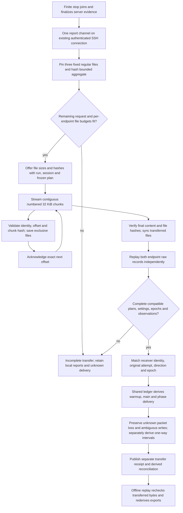

Sources: [transfer.go](internal/control/transfer.go) (`routeReportChannels`, `serveReportChannel`, `openReportSnapshot`, `serveReport`, `receiveServerReport`, `receiveReport`, `verifyTransferredFiles`), [reconcile.go](internal/control/reconcile.go) (`reconcileReports`, `reconcileOrigin`, `replayTransferred`), [replay.go](internal/control/replay.go), [exports](internal/control/export.go), [shared ledger](internal/measure/ledger.go) (`SummarizeSnapshot`), [fixtures](internal/control/transfer_test.go). Numbered frames/acks and final hashes bind exact ordered bytes to the existing enrolled-client/pinned-host session. Endpoint raw summaries remain unchanged; each observation cutoff belongs to its own clock. Lost receipts do not imply missing data; stream delivery never establishes zero network packet loss.

The per-endpoint file cap (maximum 1 GiB), remaining request budget after lifecycle/calibration reservations and whole network-transfer timeout bound work. Offline input budgets include both remote hash/replay passes; they are not heap caps. Interrupted transfer stays unknown; saved receipts are local provenance, not transferable attestations. Recovery/dashboard and native/live/impairment acceptance remain pending.

## Live SSH clock sampling

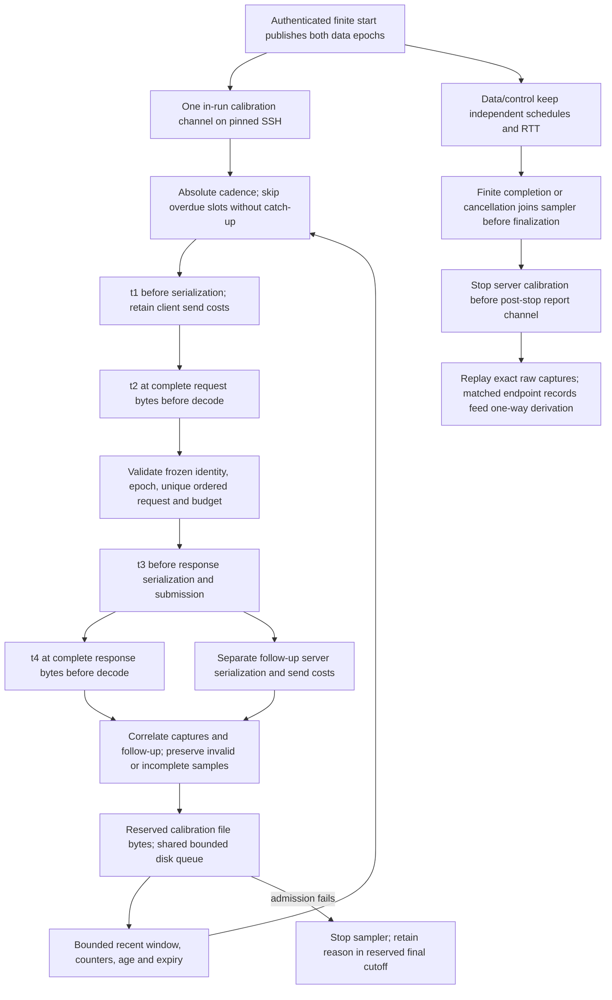

Sources: [clock.go](internal/control/clock.go) (`clockGate`, `startClock`, `run`, `clockRead`, `clockWrite`, `appendClock`, `clockWindow`), [lifecycle](internal/control/run.go) (`executeRun`, `drainJoinBudget`), [routing](internal/control/transfer.go) (`routeReportChannels`), [persistence](internal/control/evidence.go) (`Finalize`), [replay](internal/control/replay.go), [fixtures](internal/control/clock_test.go). Captures use the actual endpoint data epochs; t3 submission includes separately measured serialization/send costs, and t4 excludes follow-up arrival. Recent invalid samples remain visible and can displace older valid samples. Readiness-only sessions never sample.

Requests, 4 KiB frames/raw captures, recent attempts and event/file/queue bytes have explicit bounds. Calibration rejection, invalidity, expiry or response timeout does not cancel working data/control. If the shared SSH transport blocks channel accept/close/write past shutdown, the owned connection closes as control failure. The sole uncancellable SSH channel-open wait belongs to that connection and ends at teardown. Captures provide constraints to the separate derivation below; production clock-quality validation remains task 28.

## Uncertainty-gated one-way results

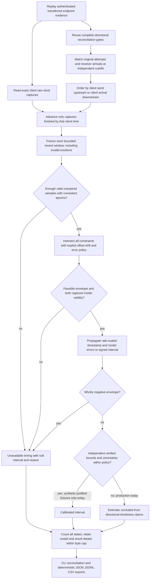

Sources: [one_way.go](internal/control/one_way.go) (`productionOneWay`, `deriveOneWay`, `oneWayQueries`, `retainOneWay`), [calibration.go](internal/calibration/calibration.go) (`Build`, `Delay`), [reconciliation](internal/control/reconcile.go) (`reconcileReports`), [replay](internal/control/replay.go), [exports](internal/control/export.go), [synthetic fixtures](internal/control/one_way_test.go), [real SSH/UDP/TCP fixtures](internal/control/clock_test.go). Revisions are reconstructed from raw captures, with hashes/sample IDs, signed bounds, age and clock-local units; future samples never upgrade earlier results. Missing receiver captures stay null. Exact populations include omitted details under min(event budget, 256 KiB). Endpoint-only RTT/delivery and raw files remain unchanged. Production verification cannot be enabled by profile/source text; independent clock-bound, native clock-change/impairment/live acceptance remains pending.
