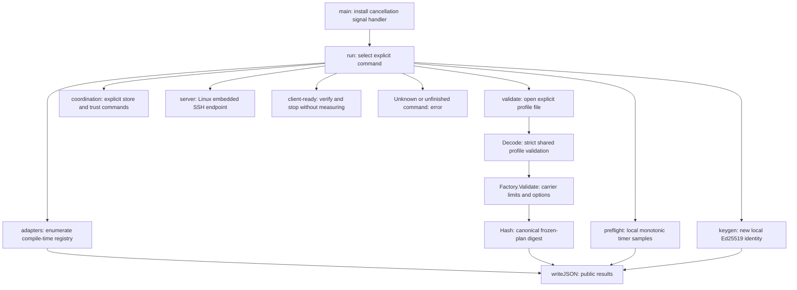
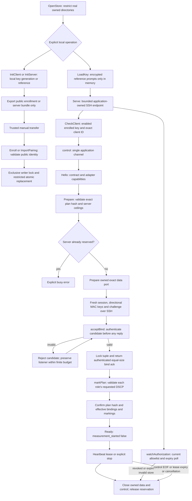
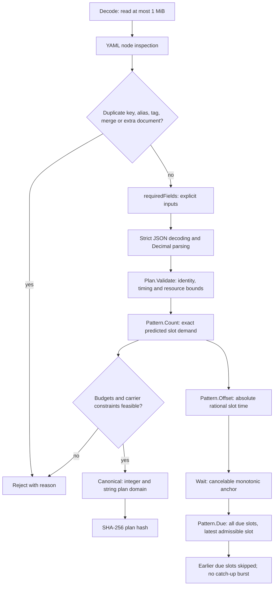
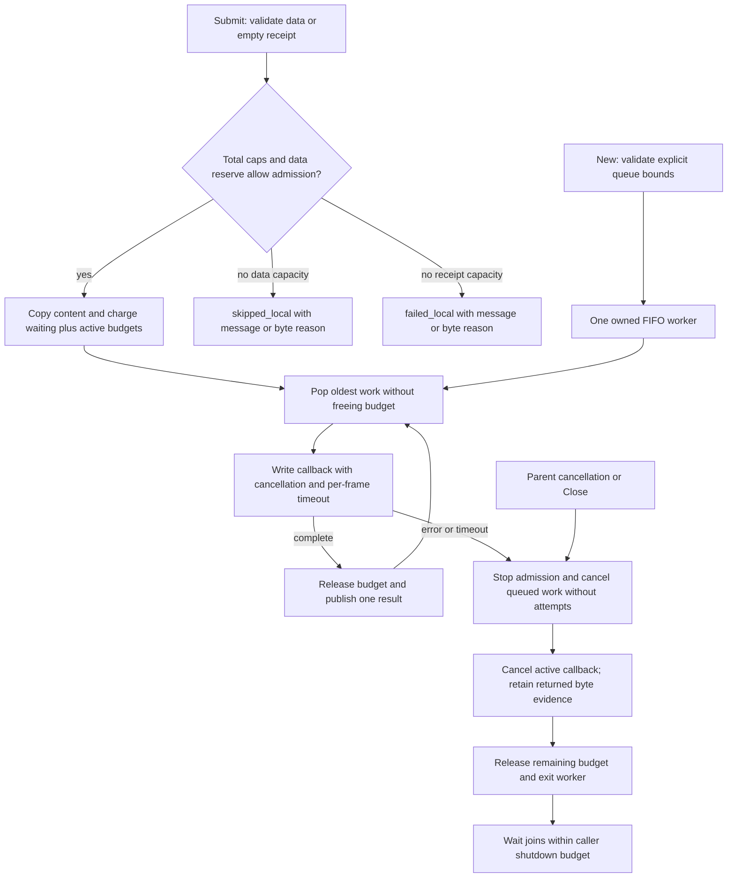
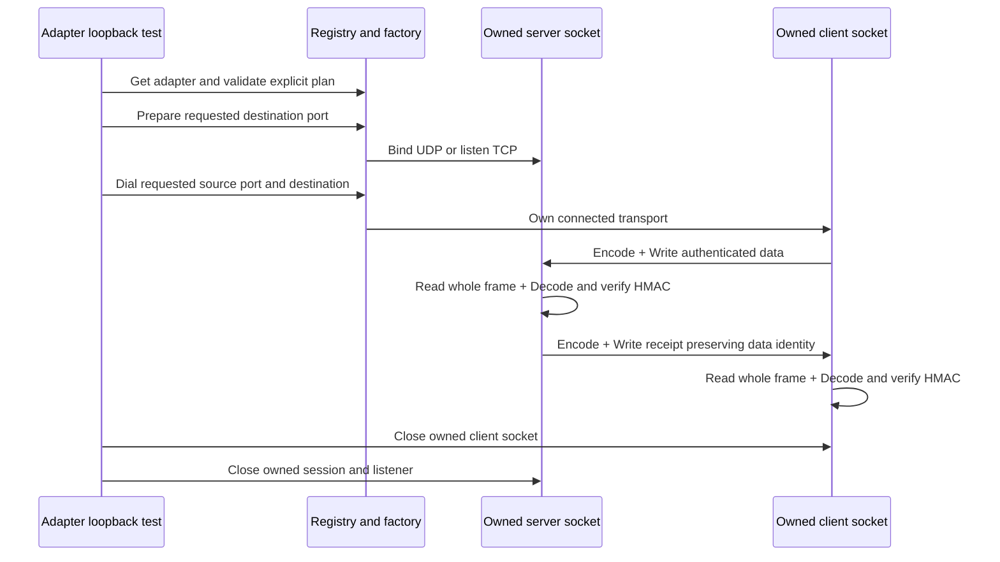
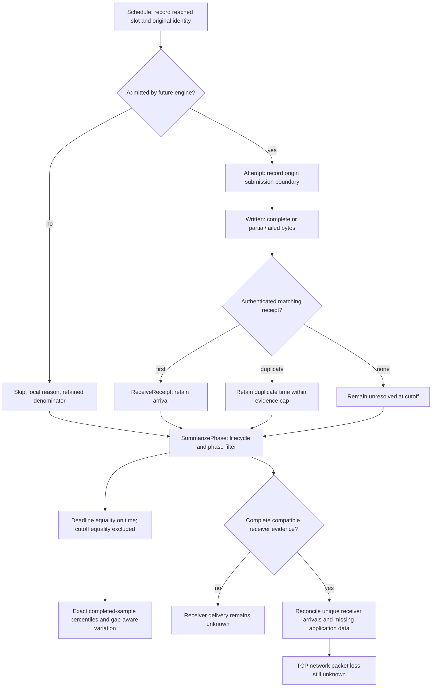
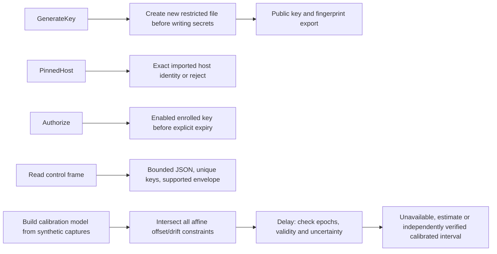

# Code flow

Updated: 2026-10-11. This describes **current foundation, authenticated readiness and bounded queue code**. Scheduled network measurement remains pending. Each function has a purpose comment; `go test ./internal/quality -v` checks declarations and anonymous functions. [Roadmap task index](ROADMAP.md#first-slice-task-index) tracks remaining work.

## Start reading here

Entry points: [main.go](cmd/sneaky-port/main.go) (`main`, `run`, `writeJSON`), [coordination.go](cmd/sneaky-port/coordination.go) (`coordination`, `keyPassphrase`, `loadSigner`). `server` is Linux-only; `client-ready` uses direct owned UDP/TCP plus SSH control. `client` measurement/dashboard mode remains unsupported. Validation/preflight open no network sockets.

## Persistent trust and endpoint readiness

Sources: [store.go](internal/control/store.go) (`OpenStore`, `InitServer`, `InitClient`, `Enroll`, `Disable`, `ImportPairing`, `writeAtomic`), [session.go](internal/control/session.go) (`NewServer`, `Serve`, `connection`, `control`, `Ready`, `acceptBind`, `checkBind`, `markPlan`, `checkEffective`, `watchAuthorization`). `Ready` checks the imported host pin before accepting session secrets. Unsupported shell/exec/forwarding/calibration/report channels are refused. Invalid UDP first tuples receive no acknowledgement and cannot pin the listener; partial TCP frames cannot authenticate. IDs/challenges/keys are fresh per preparation, and the public result contains no MAC keys.

Both roles retain actual local/remote bindings; NAT observations need not equal the client's local tuple. Marking API success leaves packet-observed values unknown. Readiness holds only a lease, counts client application-control bytes through stop, and performs no scheduler/ledger/calibration run. Disconnect/revocation cleanup produces no measurement report at this stage. [Tests](internal/control/session_test.go), [store tests](internal/control/store_test.go), [setup commands](README.md#pair-endpoints-and-check-readiness).

## Profiles and planned slots

Sources: [profile.go](internal/profile/profile.go) (`Decode`, `requiredFields`, `yamlValue`, `Plan.Validate`), [canonical.go](internal/profile/canonical.go) (`Canonical`), [schedule.go](internal/schedule/schedule.go) (`Count`, `Offset`, `Due`, `Wait`), [preflight.go](internal/measure/preflight.go) (`Preflight`). The schedule functions and ledger are separate tested primitives; a network engine has not connected them yet. Half-open phases exclude the end, and quiet/burst gaps schedule no data.

## Bounded writer queues

Sources: [queue.go](internal/writer/queue.go) (`New`, `Submit`, `Snapshot`, `run`, `stopLocked`, `popLocked`, `finishLocked`, `Close`, `Wait`), [fixtures](internal/writer/queue_test.go). Invalid/stopped submissions fail without tickets. Receipts share FIFO order and total caps; data cannot consume reserved message or 124-byte receipt capacity. Active work stays charged until the callback returns. One buffered result per accepted frame avoids blocking on report consumers; consumers own later result retention.

Callbacks own attempt timestamps, encoding, transport byte boundaries and cancellation of their owned I/O. They must return on cancellation/timeouts; arbitrary blocking code cannot be forcibly interrupted, and a bounded `Wait` exposes that violation. The queue performs no retry/drain, schedule accounting, transport writes or network-loss inference by itself. Current fixtures use callbacks only; UDP worker integration is [task 8](ROADMAP.md#8-implement-independent-udp-senderreceiver-workers).

## Real sockets and authenticated frames

The following exchange is exercised by loopback tests, not exposed as a full application run.

Sources: [adapter.go](internal/adapter/adapter.go) (`Register`, `Describe`, `Prepare`, `Dial`, `Accept`, `Reject`, `SetReadDeadline`, `Read`, `Write`, `Close`), [wire.go](internal/probe/wire.go) (`Encode`, `Decode`, `ReadTCP`, `WriteTCP`), [adapter tests](internal/adapter/adapter_test.go). UDP sends whole datagrams; TCP adds a four-byte length prefix. Decode checks the exact 92-byte header/124-byte authentication overhead, flags, content length and plan/adapter tag. Partial TCP frames never become arrivals. Production readiness uses the bind/challenge path above; scheduled data/receipts remain unconnected.

`socket.Mark` delegates to [Linux](internal/platform/marking_linux.go) or [Windows qWave](internal/platform/marking_windows.go). Requested, API-applied and independently observed marking are distinct; nonzero application failures return errors. No packet-capture/ECN acceptance gate has passed.

## Local accounting

Source: [ledger.go](internal/measure/ledger.go). `Summarize` selects main traffic; `SummarizePhase` exposes separate warmup/phase metrics. A missing receipt cannot prove missing receiver data. `ReceiverEvidence` is a caller-supplied primitive: production report compatibility/authentication and reconciliation are not implemented yet. The ledger has one owner; concurrent mutation is unsupported.

## Trust and clock evidence

Sources: [identity.go](internal/control/identity.go), [key Windows](internal/control/key_windows.go), [key Linux](internal/control/key_linux.go), [control frames](internal/control/frame.go), [calibration.go](internal/calibration/calibration.go). `DecodeObject` rejects duplicate/unknown/missing fields, invalid UTF-8 and excessive nesting; the coordinator separately checks lifecycle identities. Calibration tests inject known captures; no live sampler supplies them yet. `Policy.Verified` is only enabled by synthetic fixtures; production cannot claim calibrated timing until the independent evidence gates pass.

## Remaining connections

The independent network engine must connect the queue/schedule primitives to UDP/TCP and the start exchange. Maintained clock sampling, calibration/report SSH channels, raw report persistence/replay/export, profile stores, protected loopback API, dashboard/SVG views and matched-run comparisons remain pending. See the [acceptance contract](DESIGN.md#first-slice-implementation-contract) and [task 8](ROADMAP.md#8-implement-independent-udp-senderreceiver-workers).
